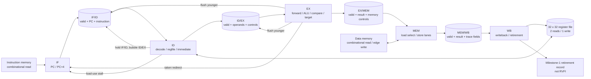

# Milestone 1 Architecture

This note summarizes the frozen and implemented M1 architecture. The normative details live in `SPEC.md`; this diagram makes the instruction and control flow visible.

`EX` is the only control-transfer decision point. An EX redirect changes the next fetch PC and clears younger IF/ID and ID/EX validity. A load-use condition holds the fetch PC and IF/ID for one cycle and injects an invalid ID/EX entry. If a redirect and stall appear together, redirect takes priority.

The two memory ports are separate and fixed latency. All architectural updates appear at WB, in order. The internal retirement record exposes that commit point without claiming RVFI semantics.
